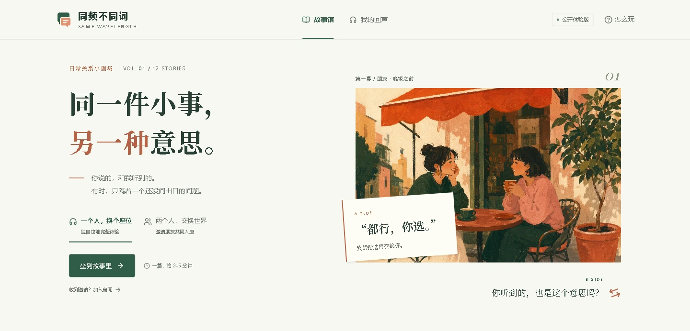
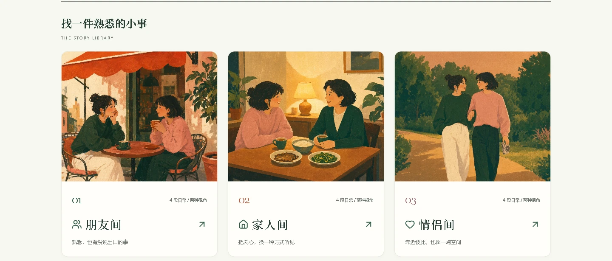
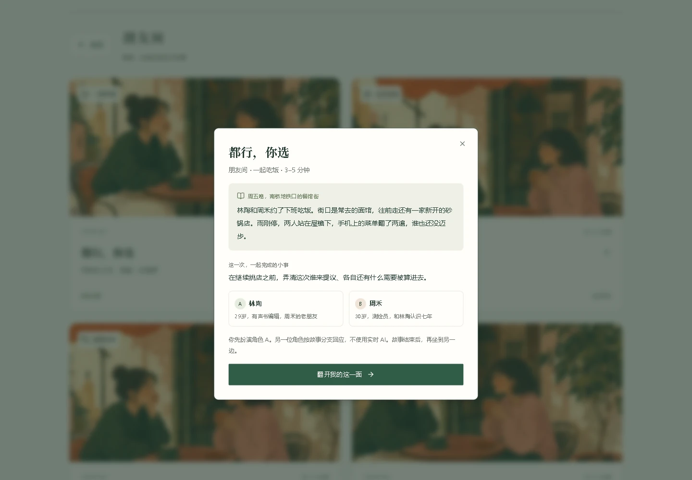

<div align="center">
  
  <h1>同频不同词</h1>
  <p><strong>同一件小事，另一种意思。</strong></p>
  <p>12 篇关于朋友、家人与恋人的互动生活小剧场<br />一个人换个座位，两个人交换世界。</p>
  <p><a href="https://same-wavelength-fhfo7md2auf.qoder.website"><strong>在线体验 →</strong></a></p>
  <p><sub>React 19 · TypeScript · Vite · Node ^22.13 或 ≥24 · 76 项测试</sub></p>
</div>

---

## 这是什么

《同频不同词》是一组可以“坐进去”的关系小剧场。每篇故事从一件再普通不过的小事开始：两家店之间的一句“都行”，群里半天没人接话，父母发来的一句“定位发一下”，或者恋人说的“你先忙吧”。

你会先拿到自己的角色背景，只看到故事的一半；三轮对话里，既要选择自己心里的本意，也要选择说出口的话，还要记录自己如何理解对方。三轮结束后，故事会揭晓另一边的处境和一条双轨回放，再回到差异最大的那一句，换一种说法重新试一次。

它不是关系测评，也不打情商分。没有实时 AI 扮演对方，不采集真实聊天记录。单人模式里，另一个角色按预设分支回应；双人模式里，两个人各自入座，各自保密自己的本意。

## 界面

### 故事馆

首页只保留三个关系入口，不再把 12 张故事卡平铺在同一屏。



### 分类场景

进入一种关系后，再按“一起吃饭 / 出去走走 / 消息往来 / 帮个小忙”选择具体故事。


### 故事预览

每一篇都能先看场景、目标与两位角色，再决定单人或双人开始。



<p align="center"></p>

## 玩法

1. **带着自己的处境入座。** 先读你的角色背景、在意的事和这次的小目标；对方的另一面暂时保密。
2. **分开记录本意与表达。** 每一幕先选“心里想的是什么”，再选“嘴上怎么说”。听的一方记录自己的理解，也可以先问清楚。
3. **三轮之后交换视角。** 看到对方没说出口的背景，回看双轨回放；挑一句差异最大的话，替对方换一种说法，再试一次。
4. **留下一点回声。** 结局没有分数，只有一句可以带走的话。完成的回声只保存在当前浏览器，也可以复制成文字留存。

单人故事约 3–5 分钟；双人房间会生成一个匿名邀请链接，双方各自持有自己的房间凭证。房间在 24 小时后失效，刷新页面可以恢复，但关闭标签页可能丢失临时身份。

## 12 个故事

| 关系 | 一起吃饭 | 出去走走 | 消息往来 | 帮个小忙 |
| --- | --- | --- | --- | --- |
| 朋友间 | 都行，你选 | 行程排满了 | 群里没人接话 | 我帮你改好了 |
| 家人间 | 怎么又剩下了 | 定位发一下 | 一个“嗯”的距离 | 房间替你收拾了 |
| 情侣间 | 今天就吃这个？ | 照片里的空位 | 你先忙吧 | 我只是想说说 |

每篇 3 幕，所有文案集中在 `content/stories.json`，构建时自动生成云端使用的 `functions/story-data.mjs`。

## 本地运行

需要 Node.js `^22.13.0` 或 `>=24.0.0`。

```sh
npm ci
npm run dev
```

`npm run dev` 会同时启动前端和本地房间服务，终端会打印实际访问地址（默认 `http://127.0.0.1:5175`）。本地房间数据写入 `.local/rooms.sqlite`，首次运行自动创建，不需要云账号或数据库配置。

| 命令 | 作用 |
| --- | --- |
| `npm run dev` | 前端 + 本地房间服务（SQLite） |
| `npm test` | 76 项 `node:test`：规则、内容、云端接口、路径与断线恢复 |
| `npm run build` | 类型检查并生成静态站点到 `dist/` |
| `npm run preview` | 本地预览 `dist/` |
| `npm run check:function` | 检查云端 Deno Function（需要 Deno，可选） |
| `npm run dev:function` | 单独启动云端 Function 的本地壳（需要 Deno，可选） |

## 技术结构

```text
content/stories.json        12 篇故事源数据（唯一内容源）
functions/engine.mjs        无依赖的游戏规则：创建、命令、投影、校验
functions/cloud-handler.mjs 云端房间接口：鉴权、幂等、限流、错误映射
functions/cloud-store.mjs   云端房间存储：CAS 版本与过期清理
functions/story-data.mjs    构建时由 stories.json 生成，请勿手改
functions/index.ts          Deno 部署入口（依赖 Sites 运行时注入的 backend）
shared/types.ts             前后端共享的类型与命令协议

src/App.tsx                 路由、故事馆、预览弹窗、回声、房间轮询
src/StoryLibrary.tsx        两级导航与进入 / 返回转场状态机
src/homepage.css            仅作用于导航与转场的样式
src/Game.tsx                对局、双轨回放、换句练习、结局
src/api.ts                  前端 API 与浏览器本地凭证
src/recovery.ts             创建 / 命令的断线恢复
dev/server.mjs              本地房间服务（SQLite）
tests/                      规则、内容、接口、恢复测试
docs/                       信息架构、实施规格与截图
```

几个关键设计：

- **规则只有一份。** `functions/engine.mjs` 不依赖文件系统、网络或 Node API，本地服务、测试和云端 Function 都调用同一套规则。
- **内容只有一份。** 故事写在 `content/stories.json`；`npm run build` 之前的 `prebuild` 会校验并同步到 `functions/story-data.mjs`，不要手改生成文件。
- **前端是静态站点。** 页面使用 hash 路由（`#library`、`#room/:id`、`#join/:id`），可以直接由任意静态托管提供；双人房间才需要 Function 与数据库。
- **动画只动 `transform` 与 `opacity`。** 进入二级页 280ms（按压 120ms + 页面 160ms），返回 240ms，统一使用 `cubic-bezier(0.22, 1, 0.36, 1)`；系统开启“减少动态效果”时降级为 120ms 淡入淡出。

## 接口与隐私

云端房间提供以下接口（路径相对于 Function 挂载前缀）：

| 方法 | 路径 | 用途 |
| --- | --- | --- |
| `GET` | `/api/health` | 健康检查与存储状态 |
| `GET` | `/api/stories` | 故事目录（仅摘要） |
| `POST` | `/api/rooms` | 创建单人或双人房间 |
| `GET` | `/api/rooms/:id` | 读取房间视图 |
| `POST` | `/api/rooms/:id/join` | 第二位玩家加入 |
| `POST` | `/api/rooms/:id/commands` | 推进一局游戏 |
| `POST` | `/api/rooms/:id/presence` | 双人在线状态 |

- 不要求登录，也不采集真实聊天。房间凭证由浏览器生成，只在请求头或请求体中传递，不进 URL；数据库只保存凭证的 SHA-256 摘要。
- 房间 24 小时过期，公开体验版对每日新建房间做额度保护；过期数据会被有界清理。
- “我的回声”使用浏览器 `localStorage`，不跨设备同步，也不上传到服务器。
- 只有 Function 能访问私有数据库；浏览器端没有数据库凭证。
- 单人模式的另一位角色完全由故事分支驱动，不调用任何模型。

## 构建与部署

```sh
npm run build
npm run preview
```

`dist/` 是完整的静态前端，可以放到任意静态托管上。但**双人房间需要后端**：本仓库的云端实现面向 Qoder Sites 的 Deno Function 与私有数据库（`function_backend` 模式）。

`functions/index.ts` 引用的 `functions/_qoder/backend.mjs` 由部署运行时注入，仓库里没有这个文件，克隆后请不要自行伪造或用本地 fixture 替代。只想体验单人或本地开发时，使用 `npm run dev` 即可，不依赖云端。

## 项目状态

- 线上体验版：[same-wavelength-fhfo7md2auf.qoder.website](https://same-wavelength-fhfo7md2auf.qoder.website)
- 首页两级导航改版已上线，规格与验收记录见 [docs/homepage-ia-spec.md](docs/homepage-ia-spec.md)
- `npm test` 76 项通过，`npm run build` 通过
- 尚未在实体手机上做长时间性能测量；现有实现只对 `transform` / `opacity` 做动画，并在 375px 宽度下验收

## 文档与来源

- [AGENTS.md](AGENTS.md)：AI / 协作者交接入口——上手顺序、工作闭环与红线
- [docs/homepage-ia-spec.md](docs/homepage-ia-spec.md)：首页信息架构、交互数值与验收清单
- [PROVENANCE.md](PROVENANCE.md)：React starter 模板来源与许可说明
- `vendor/`：随模板保留的 Shadcn 样式与原始许可

## 许可

故事文本、角色设定与三张插画为原创内容，版权归作者所有，未经许可请勿转载或用于商业用途。仓库中的前端脚手架改编自 Qoder Sites React starter，来源与许可见 [PROVENANCE.md](PROVENANCE.md)；依赖与 vendored 样式分别遵循各自的许可证。本仓库目前未附加开源许可证。
